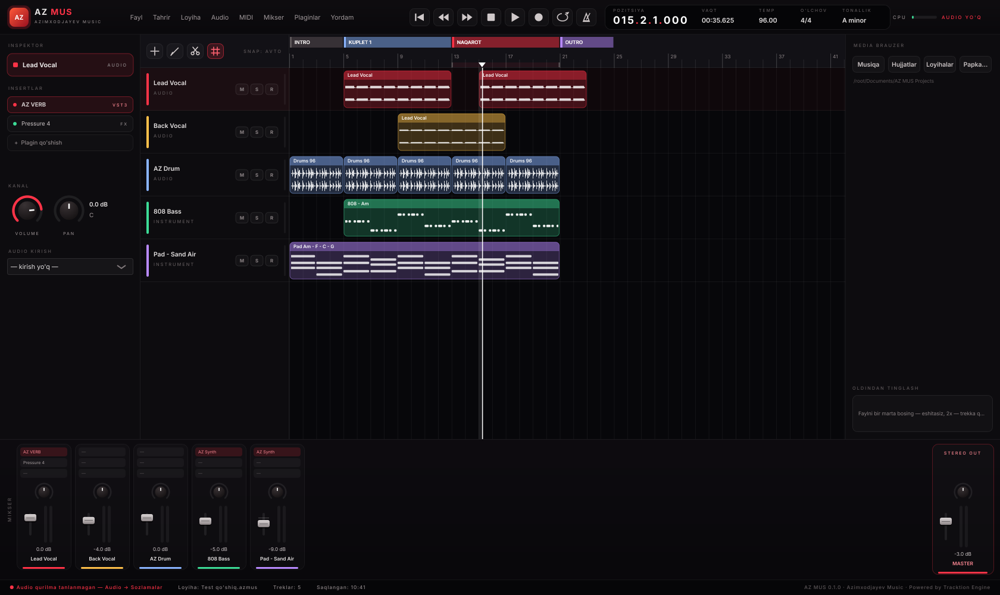
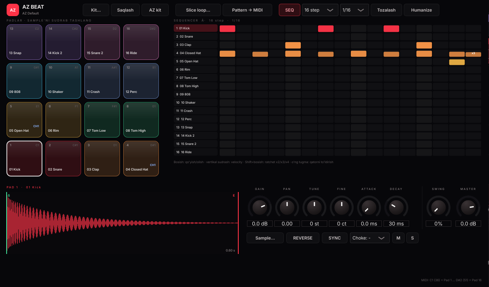
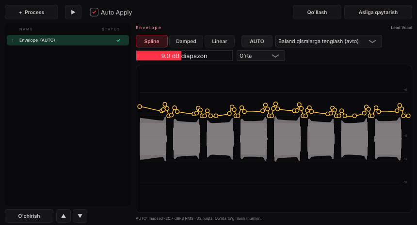
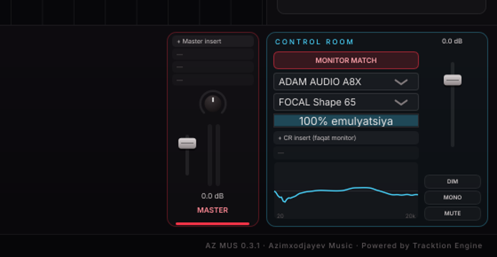

# AZ MUS: Digital Audio Workstation
**Azimxodjayev Music** · Windows · macOS · Linux · *Powered by Tracktion Engine*



## 0.1.1: xavfsiz plagin skaneri
Har bir VST3 plagin AZ MUS'ning alohida nusxasida tekshiriladi (Cubase'dagi kabi). Skanerlash vaqtida qulaydigan yoki 45 soniyadan ko'p javob bermaydigan plagin qora ro'yxatga tushadi, AZ MUS esa ochilishda davom etadi. Splash ekranni bosish skanerlashni o'tkazib yuboradi. Qora ro'yxatni tozalash: Plaginlar → VST3 plaginlarni skanerlash → Options → Clear blacklist.

## 0.9.0: Audio Editor — AudioWarp · AZ Pitch (VariAudio/Melodyne uslubi) · Xor · Vokal tozalash
Audio klipni **2 marta bosing** (yoki tanlab **Enter**) — pastki zonada **EDITOR** ochiladi (MIKSER | EDITOR yorliqlari).

| Bo'lim | Nima qiladi |
|---|---|
| **AudioWarp** | Musical Mode (asl BPM → loyiha tempi), algoritm (SoundTouch Normal/Better), hitpoint'lar ko'rinadi, **Hitpoint → Quantize** (1/4, 1/8, 1/16 + swing) |
| **AZ Pitch** | Vokal notalarga bo'linadi va "suv tomchisi" ko'rinishida chiziladi: yashil — tonallikda, sariq — biroz chetda, qizil — fals. Ichida real pitch egri chizig'i. Sudrash — yarim tonga yopishadi (Alt — erkin, cent), ↑/↓, 2x bosish — tonallikka, Shift/ramka — bir nechta, Ctrl+A |
| AUTO tuzatish (aqlli) | Har notaning markazini tonallikning eng yaqin notasiga aniq joylaydi + 35% Straighten; natija: nechta nota tuzatildi va o'rtacha og'ish (cent) |
| Correct Pitch / Straighten | Tanlangan (yoki barcha) notalarga; Auto Apply bilan darhol eshitiladi |
| **Xor / Garmoniya** | Bir bosish: 3↑ 3↓ 4↑ 5↑ 4↓ 8↓, **XOR 3**, **XOR 6** — tonallikka mos diatonik intervallar, inson kabi kechikish (15–30 ms), detune va panorama bilan yangi treklarga |
| **Vokal tozalash** | Bir bosish: HPF 80 Hz, nafasni pasaytirish, jimlikda gate, de-esser (sozlanadi; olib tashlash mumkin) |

Pitch o'zgartirish TD-PSOLA bilan — formantlar saqlanadi. Hamma tahrir DOP stekida: asl fayl o'zgarmaydi, loyiha bilan saqlanadi, "Asliga qaytarish" bor.

## 0.8.0: AZ BEAT Normalize/Delay/papkani varaqlash · plagin oynasida Play va "Qotirish" · AUTO LVL
| Funksiya | Qanday |
|---|---|
| **NORMALIZE** (AZ BEAT pad) | Past signalli sample'ni −1 dBFS cho'qqiga ko'taradi (start–end oralig'i bo'yicha) |
| **DELAY** (AZ BEAT pad) | −250 … +250 ms: sample'ni kechiktirish yoki ertaroq chalish (sekvenser, MIDI kirish va Pattern → MIDI'da) |
| **◀ ▶ / ← →** (pad to'lqini ustida) | Shu papkadagi oldingi/keyingi sample'ni yuklab, darhol chaladi. **Shift** bilan — faqat loyihaga **mos** keladiganlari |
| Moslik belgisi | Loyiha BPM va tonalligiga nisbatan: loop — BPM ✓/≈/✗ va tonallik; one-shot (kick, 808, bass) — asosiy nota va u tonallikda bormi |
| **Plagin oynasi paneli** | Har plagin oynasi tepasida ▶ ■ \|◀ — oyna ochiq bo'lsa ham Play ishlaydi; Probel va boshqa klavishlar DAW'ga uzatiladi |
| **✓ Qotirish** | Yoqilganda (yashil) oyna DAW ustida qoladi — DAW'ni bossangiz ham yo'qolmaydi; o'chirsa oddiy oyna |
| **Tinglash balandligi** | Media brauzerda "dB tinglash" slayderi (2x bosish = 0 dB) |
| **AUTO LVL** | Tanlangan sample/loop balandligi DAW mix'ining real-time balandligiga moslanadi (mix jim bo'lsa −20 dBFS RMS); trekka qo'yilganda klip gain'i ham shunga o'rnatiladi. Yoqib-o'chiriladi |

## 0.7.0: Alt-bypass · Tap ovozni buzmaydi · ikki chetdan qirqish · spektrogramma · zarba magniti · trek tartibi
| Funksiya | Qanday |
|---|---|
| **Alt + bosish insert/send'da** | Plagin yoki send yoqiladi / o'chiriladi (bypass). Inspektor, mikser, Master va Control Room'da |
| **Tap tempo** | Ijro paytida temp darhol o'zgarmaydi (ovoz uzilmaydi): o'lchangan BPM to'q sariq rangda ko'rinadi, to'xtatilganda yoki **Enter** bosilganda qo'llanadi. **Tap** bosilgach **Probel** bilan sanash mumkin; Esc — chiqish |
| **Klipni ikki chetidan qirqish** | Chap va o'ng chetda ↔ kursor; chapdan qirqishda audio joyida qoladi, audioning boshidan oldinga o'tmaydi |
| **Spektrogramma** | Mikserdagi har kanalda ≋ tugma: kanal yonida real-time panel ochiladi — **3D waterfall**, **2D** (issiqlik xaritasi) yoki **FFT** + cho'qqi; sichqoncha ostida Hz va dB; muzlatish |
| **Zarba magniti** | Qaychi (Alt yoki 2-asbob) audioda zarba boshlanishini o'zi topadi va kesish chizig'ini unga yopishtiradi (moviy chiziq + magnit belgisi). Grid panelidagi "Magnit: zarba" bilan yoqiladi/o'chiriladi |
| **Trek tartibi** | Trek nomini yuqoriga/pastga sudrang (to'q sariq chiziq joyni ko'rsatadi). Mikserda kanal nomini chapga/o'ngga sudrash ham ishlaydi |

## 0.6.0: AZ BEAT · mikserda Insert/Send · sample sinxroni · Alt-qaychi


| Funksiya | Qayerda | Nima qiladi |
|---|---|---|
| **AZ BEAT** treki | "+" → "AZ BEAT", yoki trek sarlavhasini 2x bosish | **Battery** tuzilmasi: 4×4 pad (C1–D#2), har padda Gain/Pan/Tune/Fine/Attack/Decay, Start–End, Reverse, Choke, M/S, loop SYNC. **Nerve** mexanizmi: step-sekvenser (velocity, ratchet x2–x4), 16–64 step, 1/16 · 1/8 · 1/32 · 1/16T, Swing, Humanize, qatorni to'ldirish |
| Slice loop | AZ BEAT → "Slice loop..." yoki loopni bo'sh joyga tashlash | Loop transientlar bo'yicha 16 padga bo'linadi, pattern avtomatik yoziladi |
| Pattern → MIDI | AZ BEAT | Pattern trekka MIDI klip bo'lib tushadi, ichki SEQ o'chadi |
| Standart kit | birinchi ochilishda | 16 ta sintez qilingan baraban (kick, snare, clap, hat, 808 ...) va boshlang'ich beat |
| **Mikser Insert / Send** | Har kanal tepasida | "+ Insert" (qidiruvli plagin tanlash), bosish = oyna, o'ng tugma = bypass / almashtirish / o'chirish. "+ Send" = FX kanalga yoki yangi FX kanal; sudrash = daraja, 2x = 0 dB |
| **BPM SYNC / KEY SYNC** | Media brauzer | Loop/sample tinglashda va trekka qo'yishda loyiha tempi va tonalligiga moslanadi (SoundTouch). BPM/tonallik fayl nomidan, bo'lmasa audiodan aniqlanadi; perkussiya pitch qilinmaydi. Ikkalasi alohida yoqiladi/o'chiriladi |
| **Alt = qaychi** | Aranjirovka | Alt bosilganda oq glyansli qaychi kursori; bosish = shu joyda kesish, sudrash = nusxa. Alt qo'yilsa oddiy kursor qaytadi |

## 0.5.0: Temp qutisi · Grid (Logic X) · Direct Offline Processing · Render Selection · mikser alohida oynada
| Funksiya | Qayerda | Nima qiladi |
|---|---|---|
| **Temp qutisi** | Transport, displey yonida | ♩ 96.000 ▲▼ (Shift = 0.01), sudrash, g'ildirak, 2x bosib yozish · O'lchov 4/4 · **Tap** · ▾ (×2, ÷2, yaxlitlash, tayyor BPM) |
| **Grid paneli** | Treklar ustida | Logic X tuzilmasi: **Smart · Bar · Beat** + bo'linmalar 1/1 … 1/128, **Triplet**, **Dotted** |
| Snap turi | Grid paneli | Grid · Grid Relative · Events (klip chetlari) · Magnetic Cursor |
| Quantize | Grid paneli, **Q** | Link to Grid yoki alohida qiymat; audio kliplar va MIDI notalar |
| Vaqt formati | Grid paneli yoki POZITSIYA'ni bosish | Bars+Beats · Seconds · Timecode (24/25/30/60 fps) · Samples |
| **Direct Offline Processing** | **F7**, klip menyusi, Audio menyusi | Jarayonlar steki: Envelope, Gain, Normalize, Fade In/Out, Invert, Reverse, DC, Silence. Asl fayl o'zgarmaydi, "Asliga qaytarish" bor |
| Envelope **AUTO** | DOP → Envelope | Vokal rider: past iboralarni ko'taradi, balandlarini tushiradi (baland qismlarga yoki −20/−18/−16/−14 dBFS RMS standartiga). Sukunat va ibora chetlari ko'tarilmaydi. So'ng nuqtalarni qo'lda to'g'rilash mumkin (bosish = qo'shish, sudrash, 2x/o'ng tugma = o'chirish). Spline · Damped · Linear |
| **Render Selection** | **Ctrl+Alt+B**, klip menyusi | As Separate Events / One Event · Dry / Channel Settings / Complete Signal Path / + Master FX · Tail · 16/24/32-bit float · Custom Name · joy · Mute/Keep/Remove Source |
| **Mikser alohida oynada** | Mikserdagi ↗ tugma yoki chap chetidan sudrash | Mikser o'z oynasida ochiladi, ikkinchi displeyga olib o'tsa bo'ladi. Yopilsa joyiga qaytadi |



## 0.4.0: Control Room · Monitor Match · Pro Tools uslubidagi yakuniy natija


**Control Room kanali** (Mikser F3, MASTER yonida) faqat monitorlarga boradi; eksport, bounce va mixdown'ga hech qachon tushmaydi.

| Bo'lim | Nima qiladi |
|---|---|
| **Monitor Match** | Sizning monitoringizni (manba) boshqa monitorga (maqsad) aylantiradi. Kechikishsiz minimum-phase FIR |
| Manba (12 ta) | KRK Rokit 5/6/8 G4, ADAM A8X, T5V, T7V, Yamaha HS5, JBL 305P MkII, PreSonus Eris E5, M-Audio BX5 D3, Mackie CR4-X, Behringer B2030A, **yoki o'z o'lchovingiz (REW)** |
| Maqsad (9 ta) | Genelec 8340A, Focal Shape 65, Neumann KH 310, Yamaha HS8, NS-10M, Flat, Auratone 5C, Smartfon, Avtomobil |
| % emulyatsiya | Korreksiya kuchi; egri chiziq kanalda ko'rinadi |
| 2 × CR insert | Istalgan VST3 (masalan, tashqi Monitor Match yoki Sonarworks) faqat monitor yo'lida |
| Level · DIM · MONO · MUTE | Monitor boshqaruvi |

Ichki profillar ishlab chiqaruvchi grafiklari asosidagi **taxminiy** egri chiziqlar: xonani bilmaydi. Aniq natija uchun REW + o'lchov mikrofoni bilan tinglash nuqtasida o'lchang va Plaginlar → "Monitor Match: monitor o'lchov faylini yuklash (REW)..." orqali yuklang.

**Pro Tools uslubi:** master fader yangi loyihada 0 dB (unity, avval −3 dB edi), pan law −2.5 dB markaz, mixdown 24-bit + TPDF dither yoki 32-bit float (Fayl menyusi), bounce 32-bit float (headroom yo'qolmaydi).

## 0.3.1: Master insert (mastering zanjiri)
| Qayerda | Qanday |
|---|---|
| **Mikser (F3) → MASTER kanali** | Yuqoridagi 4 ta "+ Master insert" slot: bosing → plagin qidiruvi (masalan "limit", "eq") |
| **Plaginlar menyusi** | "Master insert qo'shish (mastering)..." |
| Slotda o'ng tugma | Ochish / Bypass / O'chirish |

Master zanjiri Control Room'dan oldin turadi, shuning uchun eksport (B, WAV) ga kiradi; Control Room esa faqat monitorga ta'sir qiladi.

## 0.3.0: Audio ulanishlar, FX kanallar, plagin qidiruvi
| Yangilik | Tafsilot |
|---|---|
| **F4: Audio ulanishlar** | Inputs (yoqish, bus nomi), Outputs (Main Mix tanlash), Group/FX (FX kanallar), External FX va External Instruments (apparat qurilmalar send/return), Control Room (monitor chiqishi, balandlik, Dim −20 dB, Mono, Mute; eksportga ta'sir qilmaydi) |
| **Sendlar** | Inspektorda SENDLAR: FX kanalga post-fader send, gorizontal sudrash bilan balandlik |
| **Plagin qidiruvi** | Nom, bosh harflar yoki ishlab chiqaruvchi bo'yicha; ↑ ↓ Enter; Tab: kategoriya |
| **Sichqoncha** | Bo'sh joyda sudrash: to'rtburchak bilan belgilash; Alt + sudrash: nusxa; bir nechta klip birga ko'chadi |
| **Masshtab** | Butun DAW oynasi: − / + (menyu qatori o'ngida) yoki Ctrl + / Ctrl − / Ctrl 0 |
| **Tuzatish** | Delete klipni o'chirmasdi (Windows'da Num Del bilan bir xil kod), endi o'chiradi |

## 0.2.0: Daftar DAW klavishlari, 3 til, yopiladigan panellar
| Klavish | Vazifa |
|---|---|
| Space / Enter (Num) | Ijro (to'xtatish) |
| R / Num * | Yozish (Cubase kabi) |
| Num 0 / Num . / Num + − / Num / | Stop / boshiga / takt oldinga-orqaga / loop |
| B | Bounce Selection: audio kliplar bitta audioga; MIDI esa synth bilan audioga (yangi trek) |
| P | Locatorlar (loop) = tanlangan kliplar |
| S / Ctrl+E | Kursor joyida kesish |
| 1 2 3 4 | Asbob: tanlash / qaychi / o'chirg'ich / mute |
| H / G, Shift+H / G | Gorizontal zoom, trek balandligi |
| Ctrl+Shift+A, Ctrl+A, Esc | Hammasini ekranga sig'dirish, hammasini belgilash, bekor qilish |
| F3 / F4 / F5 / Alt+I | Mikser / Audio sozlamalari / Media brauzer / Inspektor |
| J | Snap |

Panellar (Inspektor, Media brauzer, Mikser) yopiladi va ochiladi; holati saqlanadi. Til: logotip yonidagi **UZ · RU · EN** yoki **Til** menyusi. Tuzatildi: har bir trek indikatori faqat o'z signalini ko'rsatadi.

## Versiya 0.1.0: imkoniyatlar

| Bo'lim | Nima bor |
|---|---|
| Ochilish | Splash ekran: audio drayver → MIDI → VST3 skan → kutubxona → loyiha |
| Audio | ASIO (Windows), WASAPI, CoreAudio. Trekka yozish, kirishni tanlash, avto-monitoring |
| Treklar | Audio va instrument treklar, M/S/R, rang, nom, o'chirish, undo/redo |
| Aranjirovka | Audio to'lqinlari, MIDI notalar, kliplarni sudrash, uzunlikni o'zgartirish, trekdan trekka ko'chirish, bo'lish (Ctrl+E), nusxa (Ctrl+D), snap, zoom |
| Markerlar | Chizg'ichga 2x bosish: qo'shiq bo'limi (Intro, Kuplet, Naqarot, Bridge, Outro) |
| Loop / metronom | Chizg'ichni sudrab loop zonasi, L va C tugmalari |
| MIDI | USB klaviatura tanlangan instrument trekda darhol chalinadi, MIDI yozish, MIDI import |
| Piano roll | Nota qo'yish, ko'chirish, uzunlik, o'chirish, grid 1/4…1/32, Q: kvantlash |
| Plaginlar | VST3 (AU macOS'da) hosting, plagin oynalari, bypass. 186 ta Airwindows effekti, AZ EQ/Kompressor/Delay/Chorus/Filtr, AZ Synth, AZ Sampler |
| Mikser | Fader, pan, L/R metr, insertlar, MASTER |
| Media brauzer | Sample papkalari, bir bosishda eshitish, 2x bosish yoki sudrash bilan trekka qo'shish |
| Displey | Pozitsiya (takt.hissa.1/16.tik), vaqt, temp (sudrash yoki 2x bosish), o'lchov, tonallik |
| Fayl | Loyiha `.azmus` (Windows'da 2x bosganda ochiladi), har daqiqada avto-saqlash, WAV mixdown eksport |

## Avtomatik test (`--selftest`)
Test yangi loyiha yaratadi, demo kontent qo'shadi (vokal, baraban, 808, pad, markerlar), AZ VERB VST3'ni yuklaydi, undo qiladi, saqlaydi va qayta ochadi, keyin render qilib natijani o'lchaydi. Natija: **17/17 o'tdi**, 62 s mixdown, RMS −16.8 dBFS.

## Yig'ish
GitHub Actions avtomatik yig'adi: `main`ga push qilinganda Windows `AZ-MUS-Setup.exe` va macOS zip **Releases**ga chiqadi.

Qo'lda yig'ish:
```
git clone https://github.com/Tracktion/tracktion_engine.git te
cd te && git checkout a5e44996f5f08dfa6af5f5d02d900fb3cfa37422
git -c url."https://github.com/".insteadOf="git@github.com:" submodule update --init modules/juce
cd .. && cmake -B build && cmake --build build --config Release
```
ASIO uchun Steinberg ASIO SDK'ni `./asiosdk` papkasiga qo'ying (CI buni o'zi qiladi).

## Litsenziyalar
- **Tracktion Engine**: Personal litsenziya (yillik daromad $50k gacha bepul, "Powered by Tracktion Engine" yozuvi shart). Daromad oshsa: Indie $35/oy ($200k gacha).
- **JUCE**: JUCE litsenziyasi (Personal/Indie).
- **Airwindows**: MIT. **Inter shrifti**: OFL.

## Keyingi bosqichlar
Avtomatizatsiya chiziqlari, sendlar va FX/bus treklar, audio muharrir (fade, gain, time-stretch), AZ Drum (Nerve uslubi), MIDI CC, freeze/bounce, ko'p yo'lakli eksport.
